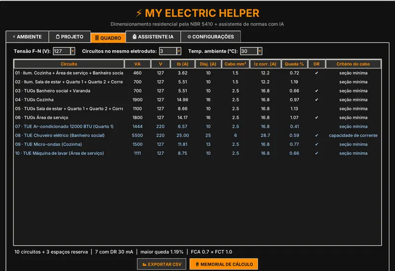
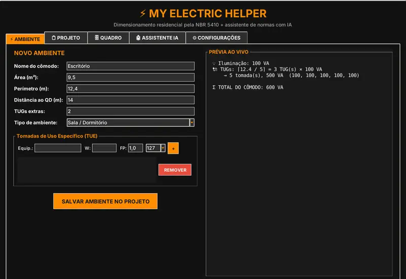
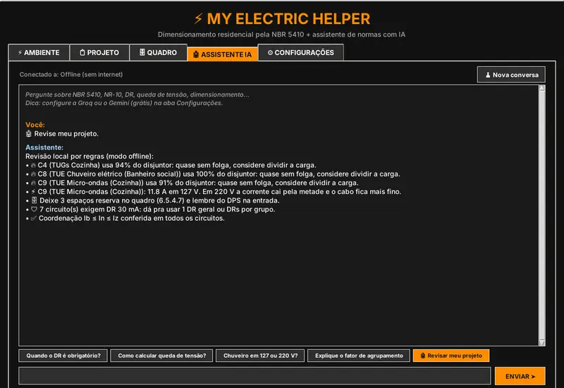

# ⚡ ME Helper — My Electric Helper

**App desktop em Python que dimensiona a instalação elétrica de uma residência pela NBR 5410** e ainda tem um
assistente com IA para tirar dúvidas de norma e revisar o projeto.

Você cadastra os cômodos (área, perímetro, equipamentos) e ele calcula iluminação, tomadas, divide os circuitos,
escolhe disjuntor e cabo, confere queda de tensão e DR, e gera o memorial de cálculo.




---

## ✨ O que ele faz

- **Carga de cada cômodo** pela NBR 5410: iluminação (100 VA até 6 m² + 60 VA a cada 4 m²), quantidade mínima de
  TUGs pelo perímetro (regras diferentes para sala/quarto, cozinha/área de serviço, banheiro, varanda) e TUEs
  (chuveiro, ar-condicionado, micro-ondas...) com fator de potência.
- **Prévia ao vivo** enquanto você digita, com a memória de cálculo.
- **Quadro de distribuição automático:** agrupa os circuitos, calcula corrente, escolhe **disjuntor** e **seção do cabo**
  (critério de capacidade de corrente com **FCA** e **FCT**, e seção mínima), confere **queda de tensão**,
  coordenação **Ib ≤ In ≤ Iz**, marca onde o **DR** é obrigatório e sugere **espaços reserva**.
- **Assistente de normas com IA:** pergunte sobre NBR 5410, NR-10, DR, queda de tensão... e peça para **revisar o
  projeto**. Funciona com **Groq** ou **Gemini** (grátis), **Ollama** (local) ou **modo offline** (regras próprias,
  sem internet).
- **Salvar/abrir projeto** (JSON), **exportar CSV** e **memorial de cálculo em HTML** (vira PDF pelo navegador).

| Cadastro do cômodo | Assistente com IA |
|---|---|
|  |  |

## 🧱 Como o código é organizado

Um arquivo só, em camadas (cada uma só usa as anteriores):

| Camada | O que tem |
|---|---|
| 1. Normas | Tabelas da NBR 5410: disjuntores comerciais, Iz por seção, FCA, FCT, reservas |
| 2. Exceções | Erros próprios (`DadosInvalidosErro`, `DimensionamentoErro`, `IAErro`...) |
| 3. Modelos (POO) | `Ambiente` abstrata + subclasses por tipo de cômodo (registro automático via `__init_subclass__` e fábrica), `TUE`, `Projeto` |
| 4. Cálculos | Montagem do quadro, disjuntor, cabo, queda de tensão, revisão por regras |
| 5. Persistência | JSON, CSV e memorial HTML |
| 6. IA | Interface `ProvedorIA` com Groq, Gemini, Ollama e Offline (troca sem mudar o resto do código) |
| 7. Interface | Telas em Tkinter, com a IA rodando em outra thread pra janela não travar |

Conceitos de Programação usados: classes abstratas, herança e polimorfismo, `dataclasses`, `@property`,
fábrica com registro automático, exceções personalizadas, threads + fila, validação de entrada
(ex.: rejeita perímetro geometricamente impossível para a área informada).

## 🚀 Como rodar

Precisa só do **Python 3.10+** (nenhuma biblioteca extra):

```bash
python ME_Helper.pyw
```

No Windows, dois cliques no arquivo já abrem o app.

Para usar a IA online, pegue uma chave grátis em [console.groq.com/keys](https://console.groq.com/keys) ou
[aistudio.google.com/apikey](https://aistudio.google.com/apikey) e cole na aba **Configurações**.
A chave fica em `me_helper_config.json`, fora do código (também dá pra usar as variáveis `GROQ_API_KEY` e `GEMINI_API_KEY`).

## 📌 Sobre

Feito por **Davi Sales** (Engenharia Civil, UFRJ Macaé · Técnico em Eletromecânica) como trabalho de
Programação 1 e evoluído em Programação 2 (v5).

> ⚠️ Ferramenta de estudo e pré-dimensionamento. Projeto elétrico de verdade precisa de um profissional
> habilitado e responsável técnico.
